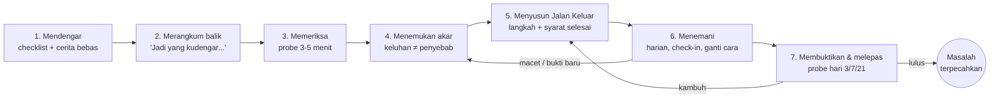

# Ceritakan Masalahmu → Jalan Keluar

Status: **RANCANGAN** — belum ada satu baris kode yang dibangun. Dokumen ini menyempurnakan ide
owner dan memetakan apa yang harus dibangun di atas sistem FIEZEL yang sudah ada.

Wewenang: OWNER (ide asli) · disempurnakan 2026-10-12.

---

## 0. Ringkasan dalam satu paragraf

Di Home ada pintu **"Ceritakan masalahmu"**. Murid mencentang apa yang terasa berat (grammar,
listening, reading, speaking, writing, kebiasaan, perasaan) atau menuliskannya dengan kata-katanya
sendiri. FIEZEL **tidak langsung percaya** pada keluhan itu, sama seperti guru sungguhan tidak
langsung percaya. Ia memeriksa dulu selama 3–5 menit untuk menemukan **akar masalahnya**, karena
"aku lemah di listening" sering ternyata masalah kosakata, dan "aku susah menghafal grammar" sering
ternyata masalah cara belajar. Dari akar itu FIEZEL menyusun **Jalan Keluar**: rencana bertahap yang
memakai aktivitas yang sudah ada di aplikasi, masing-masing dengan syarat selesai yang bisa diukur.
Pau menemani setiap hari, mengganti cara kalau satu cara tidak berhasil, dan **baru menyatakan
masalahnya selesai setelah terbukti bertahan 21 hari**, bukan setelah murid sekadar rajin latihan.

---

## 1. Ide owner, dan tiga hal yang membuatnya brilian

Ide owner:

> Di hero Home ada tombol *Ceritakan masalahmu*. Murid memilih dari checklist (sulit menghafal
> grammar, susah listening, reading, speaking, writing, dan lain-lain). FIEZEL menyusun rencana
> adaptif untuk murid itu dan menuntunnya langkah demi langkah sampai semua masalahnya terlewati.

Ide ini sudah benar arahnya: ia membuat FIEZEL **memulai dari murid**, bukan dari kurikulum. Agar
benar-benar terasa seperti guru manusia, ada tiga peningkatan yang membedakan "aplikasi dengan
formulir keluhan" dari "tutor yang memahami muridnya":

1. **Keluhan adalah hipotesis, bukan diagnosis.** Murid tahu *di mana rasanya sakit*, tetapi
   jarang tahu *apa penyebabnya*. Guru sungguhan mendengar dulu, lalu memeriksa. FIEZEL juga:
   setiap keluhan menaikkan dugaan terhadap beberapa akar, lalu pemeriksaan singkat yang
   memutuskan akar mana yang benar.
2. **"Selesai" berarti terbukti bertahan, bukan sudah latihan.** Masalah dinyatakan terpecahkan
   hanya setelah probe tertunda pada hari ke-3, ke-7, dan ke-21 lulus — mesinnya sudah ada di
   `features/brain/fiezel-retention-probe.js`. Murid akhirnya memegang bukti, bukan janji.
3. **Perasaan dan kebiasaan adalah masalah sungguhan.** "Takut salah", "cemas saat ujian",
   "sering berhenti", dan "cepat bosan" masuk ke checklist yang sama dengan "susah listening",
   dengan intervensi berbasis riset. Murid yang berhenti belajar biasanya bukan karena tidak
   paham grammar.

Nama fiturnya: **Jalan Keluar** (th: **ทางออก**). Tombolnya tetap memakai kata-kata owner:
*Ceritakan masalahmu* (th: *เล่าปัญหาของคุณให้ฟัง*).

---

## 2. Tujuh gerakan guru sungguhan

Seluruh fitur adalah satu putaran yang meniru apa yang dilakukan guru privat yang baik:



| Gerakan | Apa yang dilakukan guru manusia | Apa yang dilakukan FIEZEL |
|---|---|---|
| 1. Mendengar | Membiarkan murid bercerita tanpa dipotong | Checklist berkelompok + kolom "ceritakan dengan kata-katamu" |
| 2. Merangkum balik | "Jadi, kamu merasa…" — murid merasa dipahami | Kalimat rangkuman dari templat, murid menjawab *Benar* / *Ada yang kurang* |
| 3. Memeriksa | Memberi beberapa soal yang dipilih khusus | Probe pembeda: soal yang dipilih karena paling bisa membedakan dua dugaan teratas |
| 4. Menemukan akar | "Oh, sebenarnya masalahmu di sini" | Pohon akar dengan tingkat keyakinan; jujur bilang *belum yakin* bila bukti tipis |
| 5. Menyusun rencana | Rencana yang realistis, satu fokus dulu | Maksimal 7 langkah, satu masalah aktif, urutan mengikuti prasyarat |
| 6. Menemani | Menanyakan kabar, mengganti cara bila buntu | Check-in mingguan, deteksi macet, *Rencana B*, kontrak mini |
| 7. Membuktikan & melepas | Ulangan beberapa minggu kemudian, lalu melepas | Probe tertunda 3/7/21 hari, kartu *Dulu vs Sekarang*, bantuan memudar |

---

## 3. Pengalaman murid — contoh nyata

**Rani, kelas 8, level A2.** Ia mencentang *"Orang bicara terlalu cepat"* dan *"Cepat lupa
kosakata"*.

1. **Pau menyapa dan menormalkan.** "Banyak yang merasakan hal yang sama. Biasanya ada satu
   penyebab yang bisa dicari, dan kita akan mencarinya bersama." Tidak ada pujian atau label
   pada orangnya — aturan nada yang sama dengan `fiezel-olm.js` dan `fiezel-tutor-brain.js`.
2. **Prioritas.** Dua masalah dicentang. Pau: "Aku sarankan kita mulai dari kosakata, karena
   listening-mu banyak bergantung padanya. Tapi kamu yang memutuskan." Rani tetap memilih
   listening. Pilihannya dihormati; kosakata masuk antrean.
3. **Rangkum balik.** "Jadi yang kudengar: saat orang bicara cepat, kamu ketinggalan. Benar?"
   → *Benar*.
4. **Pemeriksaan 4 menit**, tiga probe pembeda:
   - kalimat yang sama ditampilkan sebagai **teks** → Rani paham 9/10;
   - lalu diputar sebagai **audio kecepatan normal** → paham 4/10;
   - diputar **lambat** → paham 8/10;
   - **dikte frasa sambung** ("did you" → /dɪdʒə/, "want to" → /wɒnə/) → 1/5.
5. **Akar yang ditemukan.** Bukan kosakata (teksnya dipahami). Penyebab yang paling mungkin:
   **bentuk bunyi kata sambung** (keyakinan tinggi) dan **kecepatan memproses** (sedang). Pau
   menunjukkannya sebagai bar dengan rentang, bukan angka tunggal, dan ada tombol *"Menurutku
   bukan ini"*.
6. **Jalan Keluar, 6 langkah, ±3 minggu:**
   1. Dikte frasa sambung, lambat → normal (7 menit/hari)
   2. Shadowing 5 kalimat di Bicara Privat
   3. Listening detail dengan kecepatan naik bertahap (tombol `rateBand` di listening adaptif)
   4. Kuota putar ulang dikurangi 3 → 1
   5. Satu cerita audio utuh tanpa teks
   6. Probe bukti: hari ke-3, ke-7, ke-21
   Setiap langkah punya syarat selesai yang ditulis dalam bahasa murid: *"Selesai saat kamu
   benar 8 dari 10 di kecepatan normal, dua sesi berturut-turut."*
7. **Kontrak mini.** "Kapan kamu biasanya punya 7 menit?" → "Setelah makan malam." Pengingat
   memakai jalur notifikasi yang sudah ada.
8. **Hari ke-9, macet.** Langkah 3 tidak naik dalam tiga sesi dan afek terbaca frustrasi. Pau
   tidak mengulang cara yang sama: "Cara ini belum cocok. Kita coba klip yang lebih pendek
   dulu." (Rencana B; prinsip yang sama dengan *jangan ulang penjelasan yang gagal* di Tutor
   Brain.)
9. **Hari ke-24, lulus.** Probe hari ke-21 lulus. Kartu **Dulu vs Sekarang**: "Hari pertama:
   4/10 di kecepatan normal. Hari ini: 9/10." Masalah tercap *terpecahkan*. Antrean berikutnya
   — kosakata — ditawarkan, tidak dipaksakan.

---

## 4. Katalog keluhan (checklist)

Dikelompokkan supaya murid tidak tenggelam dalam daftar panjang. Satu centang = satu keluhan.
Kolom *dugaan akar* memakai kode di §5; bobotnya (prior) disimpan di berkas taksonomi, bukan di
dokumen ini.

| Kelompok | id | Indonesia | ไทย | Dugaan akar |
|---|---|---|---|---|
| Grammar | `gr_hafal` | Sulit menghafal rumus grammar | จำสูตรไวยากรณ์ไม่ค่อยได้ | K12, K5 |
| Grammar | `gr_pakai` | Tahu rumusnya, tapi salah saat dipakai | รู้สูตรแต่พอใช้จริงก็ผิด | K6, K7 |
| Grammar | `gr_tenses` | Bingung memilih tenses | สับสนว่าจะใช้ tense ไหน | K5, K7 |
| Kosakata | `vo_lupa` | Cepat lupa kosakata | ลืมคำศัพท์เร็ว | K2, K12 |
| Kosakata | `vo_sedikit` | Kosakataku terlalu sedikit | รู้คำศัพท์น้อยเกินไป | K1 |
| Listening | `li_cepat` | Orang bicara terlalu cepat | คนพูดเร็วเกินไป ฟังไม่ทัน | K3, K4, K1 |
| Listening | `li_isi` | Dengar kata per kata, tapi tidak paham isinya | ฟังออกเป็นคำ ๆ แต่ไม่เข้าใจใจความ | K4, K10, K5 |
| Listening | `li_kenal` | Kata yang kutahu tidak kukenali saat didengar | คำที่รู้อยู่แล้ว พอได้ยินกลับจำไม่ได้ | K3 |
| Reading | `re_lambat` | Membaca lambat, harus menerjemahkan satu per satu | อ่านช้า ต้องแปลทีละคำ | K9, K1 |
| Reading | `re_maksud` | Paham kata-katanya, tidak paham maksudnya | เข้าใจคำศัพท์ แต่ไม่เข้าใจความหมายที่ซ่อนอยู่ | K10 |
| Speaking | `sp_takut` | Takut atau malu berbicara | กลัวหรืออายที่จะพูด | K14, K8 |
| Speaking | `sp_macet` | Tahu jawabannya, tapi kalimatnya tidak keluar | รู้คำตอบแต่พูดออกมาไม่ได้ | K8, K6 |
| Speaking | `sp_ucap` | Pengucapanku sulit dimengerti | ออกเสียงแล้วคนอื่นฟังไม่เข้าใจ | K7, K3 |
| Writing | `wr_mulai` | Tidak tahu harus mulai menulis dari mana | ไม่รู้จะเริ่มเขียนจากตรงไหน | K11 |
| Writing | `wr_terjemah` | Tulisanku terasa seperti terjemahan | งานเขียนเหมือนแปลมาจากภาษาแม่ | K7, K1 |
| Kebiasaan | `ha_berhenti` | Sering berhenti, tidak konsisten | เรียนไม่สม่ำเสมอ หยุดบ่อย | K13 |
| Kebiasaan | `ha_bosan` | Cepat bosan | เบื่อเร็ว | K15, K13 |
| Kebiasaan | `ha_lupa_lagi` | Sudah belajar, lupa lagi setelah beberapa hari | ผ่านไปไม่กี่วันก็ลืมอีก | K2, K12 |
| Kebiasaan | `ha_mulai` | Tidak tahu harus mulai dari mana | ไม่รู้จะเริ่มจากตรงไหน | (penempatan level) |
| Perasaan | `fe_ujian` | Cemas atau panik saat ujian | กังวลหรือตื่นเต้นตอนสอบ | K14 |
| Perasaan | `fe_tertinggal` | Merasa tertinggal dari teman | รู้สึกตามเพื่อนไม่ทัน | K14, K13 |
| Target | `tg_ujian` | Ada ujian sebentar lagi (pilih tanggal) | ใกล้สอบแล้ว (เลือกวันที่) | mode tenggat (§8.5) |

Tiga isian kecil per keluhan yang dicentang, semuanya opsional dan berupa ketukan, bukan ketikan:

- **Seberapa mengganggu?** sedikit · lumayan · sangat
- **Kapan paling terasa?** di kelas · saat ujian · saat ngobrol · saat belajar sendiri
- **Sudah berapa lama?** baru-baru ini · beberapa bulan · sejak lama

### 4.1 Cerita bebas tanpa model bahasa

Kolom *"Ceritakan dengan kata-katamu"* diproses **di perangkat** oleh pencocok kata kunci
dwibahasa (id + th): "ngebut", "cepet banget", "ไม่ทัน" → saran `li_cepat`. Hasilnya hanya
**menyarankan centangan**; murid yang memutuskan. Teks bebasnya tidak pernah meninggalkan
perangkat. Pemakaian model bahasa di server adalah fase opsional (§13, Fase 5) dan tunduk pada
aturan yang sudah berlaku di `fiezel-personal-journey.js`: *AI boleh menjelaskan, tidak boleh
memilih.*

### 4.2 Satu masalah aktif

Murid boleh mencentang sebanyak apa pun, tetapi hanya **satu masalah yang aktif** pada satu
waktu (ditambah maksimal dua di antrean yang terlihat). Guru yang baik tidak menyerang tujuh
masalah sekaligus. Pau menyarankan urutan dari graf prasyarat lintas skill (kosakata sebelum
listening, aturan sebelum otomatisasi), tetapi **murid bisa menimpa saran itu** — rasa memegang
kendali adalah bagian dari motivasi.

---

## 5. Akar masalah

Keluhan dipetakan ke **akar** (cause node). Akar inilah yang diperiksa, dilatih, dan dibuktikan.

| Kode | Akar | Contoh tanda |
|---|---|---|
| K1 | Cakupan kosakata kurang | Teks pun tidak dipahami |
| K2 | Ingatan tidak dijadwalkan ulang | Benar hari ini, salah 3 hari kemudian |
| K3 | Bentuk bunyi tidak dikenali (kata sambung, reduksi) | Paham teks, gagal dikte frasa sambung |
| K4 | Kecepatan memproses | Paham saat lambat, gagal saat normal |
| K5 | Aturan belum dipahami | Gagal di langkah *deteksi cue* atau *pemetaan aturan* (step tutor) |
| K6 | Aturan paham, belum otomatis | Pilihan ganda benar, ketik sendiri salah |
| K7 | Pola bahasa ibu terbawa (L1) | Pola miskonsepsi aktif yang khas L1 |
| K8 | Kalimat lisan tidak keluar | Waktu mulai bicara lama, kalimat terpotong |
| K9 | Strategi membaca kata per kata | Kecepatan baca rendah, pemahaman cukup |
| K10 | Inferensi dan wacana | Detail benar, pertanyaan *mengapa* salah |
| K11 | Perencanaan tulisan | Tulisan tanpa struktur, mogok di awal |
| K12 | Cara belajar kurang efektif (membaca ulang, menghafal massal) | Jawaban kuesioner strategi + pola lupa |
| K13 | Kebiasaan dan konsistensi | Tingkat sesi ditinggalkan tinggi, jeda panjang |
| K14 | Afek: cemas, takut salah | Pengakuan murid + afek frustrasi berulang |
| K15 | Tantangan tidak pas (terlalu mudah) | Afek *bored* di `fiezel-affect.js` |

**K7 berbeda untuk murid Indonesia dan Thai.** Prior dan mini-pelajaran dipilih menurut L1:

- **id:** -s orang ketiga hilang (*she go*), penanda waktu tanpa perubahan kata kerja, artikel
  hilang, jamak tidak ditandai.
- **th:** konsonan akhir hilang (*-s*, *-ed*, *-t*), tertukar /r/–/l/, tekanan suku kata
  mengikuti pola nada, penanda waktu tanpa perubahan kata kerja.

Ini detail kecil yang membuat murid Thai merasa FIEZEL memang dibuat untuk mereka, bukan
terjemahan dari aplikasi Indonesia.

---

## 6. Pemeriksaan: diagnosis pembeda

### 6.1 Prinsip

Guru tidak memberi tes 50 soal untuk menemukan masalah. Ia memberi **soal yang membedakan dua
dugaan teratas**. FIEZEL melakukan hal yang sama secara matematis: dari pustaka probe, pilih probe
yang **paling mengurangi ketidakpastian** atas akar (perolehan informasi terbesar terhadap
posterior saat ini), jalankan, perbarui, ulangi. Berhenti saat:

- satu akar mencapai keyakinan ≥ 0,7, **atau**
- anggaran waktu habis (default 5 menit, maksimal 3 probe), **atau**
- murid memilih *lewati* — pemeriksaan lalu menjadi langkah pertama di Jalan Keluar, tidak
  dibuang.

Bila bukti tipis, hasilnya ditulis **"belum yakin, kita ukur sambil jalan"**, bukan tebakan yang
terdengar pasti — prinsip yang sama dengan `fiezel-olm.js` dan `fiezel-core-brain.js`.

### 6.2 Pustaka probe

Sebagian besar probe **tidak memerlukan konten baru**; ia memakai bank yang sudah ada dengan cara
baru.

| Probe | Membedakan | Bahan | Status bahan |
|---|---|---|---|
| P1 Teks vs audio | K1/K5 vs K3/K4 | `script` item listening ditampilkan sebagai teks, lalu diputar | Ada: 1.407 item `listening-bank-v1.json` |
| P2 Lambat vs normal | K4 | Item yang sama, `rateBand` slow vs natural | Ada: `fiezel-listening-adaptive.js` |
| P3 Dikte frasa sambung | K3 | Frasa reduksi ("gonna", "did you") | **Perlu bank baru kecil** (±60 frasa A1–B1); mode `dictation` sudah ada (207 item) |
| P4 Kenal vs pakai | K5 vs K6 | Satu aturan sebagai pilihan ganda, lalu sebagai ketikan | Ada: `fiezel-production-grader.js` + cloze bank |
| P5 Langkah penalaran | jenis K5 | Soal dipecah jadi langkah (cue → aturan) | Ada: `fiezel-step-tutor.js` |
| P6 Cek kosakata cepat | K1 | 10 kata acak per level | Ada (pakai level sebagai proksi frekuensi; `vocabulary-master.json` belum punya kolom frekuensi) |
| P7 Ingat yang lama | K2 | Item yang dipelajari ≥ 3 hari lalu | Ada: jadwal memori core brain |
| P8 Ucapkan tiga kalimat | K8, K14 | Waktu mulai bicara + cakupan konsep | Ada tetapi tipis: 36 item `speaking-bank-v1.json` |
| P9 Baca berwaktu | K9 | Kecepatan baca + pemahaman | Ada: `reading-bank.json` (perlu pencatat waktu baca) |
| P10 Pertanyaan *mengapa* | K10 | Mode `inference` | Ada: 240 item listening + item reading |
| P11 Tiga pertanyaan cara belajar | K12, K13 | Kuesioner ketuk | **Perlu ditulis** (id + th) |
| P0 Bukti yang sudah ada | semua | Riwayat, ledger miskonsepsi, afek, tingkat sesi ditinggalkan | Ada, biaya nol — selalu dijalankan pertama |

**P0 selalu duluan.** Murid yang sudah lama memakai FIEZEL mungkin tidak perlu probe sama sekali:
ledger miskonsepsi, BKT, dan riwayat afek sudah cukup untuk menaikkan keyakinan.

### 6.3 Kejujuran yang wajib

- **Pengucapan tidak dinilai.** `fiezel-speaking-adaptive.js` sudah menegaskan pengenal suara
  browser bukan skor pengucapan. Keluhan `sp_ucap` dijawab dengan latihan *model-first* dan
  pasangan minimal, **tanpa** angka pengucapan.
- **Tidak ada prediksi skor ujian**, sama dengan R2/R4.
- **Sanggahan berkonsekuensi.** Tombol *"Menurutku bukan ini"* menaikkan ketidakpastian akar itu
  dan memicu pengukuran ulang (`negotiate()` di `fiezel-olm.js`), bukan sekadar tombol keluhan.

---

## 7. Jalan Keluar: rencana

### 7.1 Bentuk rencana

Lima fase. Tidak setiap rencana memakai semuanya.

1. **Ukur** — hanya bila pemeriksaan dilewati atau belum yakin.
2. **Fondasi** — melatih akar (mis. bentuk bunyi), bukan gejalanya.
3. **Latih terarah** — skill yang dikeluhkan, kesulitan naik satu dimensi per langkah.
4. **Pakai sungguhan** — transfer: cerita utuh, buku perpustakaan, Panggung Suara, menulis bebas.
5. **Buktikan** — probe tertunda hari ke-3, ke-7, ke-21.

Batas keras: **maksimal 7 langkah**, satu langkah ≈ satu sesi harian pendek, setiap langkah punya
**syarat selesai berbasis bukti** (bukan menit atau jumlah klik), dan setiap langkah membawa kode
alasan (rationale code) supaya layar *"kenapa langkah ini?"* tidak mengarang alasan.

### 7.2 Resep: akar → aktivitas yang sudah ada

Jalan Keluar **tidak membuat jenis latihan baru**. Ia adalah dirigen yang memanggil alat musik yang
sudah ada.

| Akar | Aktivitas (sudah ada di aplikasi) | Contoh syarat selesai |
|---|---|---|
| K1 | Flashcards per level, kosakata harian Home, buku perpustakaan level i−1 | 80% benar pada 20 kata target, dua sesi |
| K2 | Review SRS (porsi review dinaikkan), Stempel Ingatan | Probe hari ke-7 lulus |
| K3 | Dikte lambat → normal, shadowing di Bicara Privat | Dikte frasa sambung ≥ 4/5 pada kecepatan normal |
| K4 | Tangga `rateBand` → `clipLength` → kuota replay (listening adaptif) | ≥ 80% pada *natural*, replay ≤ 1, dua sesi |
| K5 | Lesson grammar + video grammar + step tutor + contoh terurai | Lulus langkah *cue* dan *aturan* pada 5 soal |
| K6 | Mode ketik (production grader), latihan campur, duel Paw Arena | BKT L ≥ 0,95 dengan n ≥ 5 pada lesson target |
| K7 | Pasangan kontras dari ledger miskonsepsi + mini-pelajaran L1 (id/th) | Miskonsepsi berstatus RESOLVED di ledger |
| K8 | Bicara Privat dengan kerangka kalimat, teknik 4/3/2 (ulang cerita makin singkat) | Waktu mulai bicara turun, cakupan ≥ target |
| K9 | Reading berwaktu, membaca per frasa, buku perpustakaan mudah | Kecepatan naik tanpa pemahaman turun |
| K10 | Soal *inference* reading/listening dengan pertanyaan *mengapa* | ≥ 70% pada soal inference, dua sesi |
| K11 | Writing prompt dengan templat rencana (ide → alasan → contoh) | Satu tulisan memenuhi rubrik struktur |
| K12 | Kartu strategi SRL: uji diri > baca ulang; lalu bukti N-of-1 milik murid sendiri | Murid memakai uji diri 3 sesi, retensi naik |
| K13 | Kontrak mini + sesi 3 soal + rencana pemulihan | Kontrak ditepati 4 dari 7 hari, dua minggu |
| K14 | Menulis kecemasan 2 menit sebelum ujian, tangga paparan bicara (sendiri → AI → teman → panggung) | Tangga paparan dinaikkan; tidak pernah dikunci oleh afek saja |
| K15 | Tantangan dinaikkan, latihan campur, Nujum, Undercover | Afek *bored* tidak muncul lagi tiga sesi |

### 7.3 Satu rencana, bukan dua

Bahaya terbesar fitur ini adalah menciptakan **rencana kedua yang bersaing** dengan *Rencana Hari
Ini*. Aturannya:

- Saat ada masalah aktif, langkah Jalan Keluar **mengisi blok `focus`** di `buildTodayPlan()`
  (`features/personal-journey/fiezel-personal-journey.js`). Blok review wajib tetap ada.
- Tombol utama Home tetap satu (kontrak `tests/ux-redesign-test.js` B2). Kartu Jalan Keluar memakai
  gaya kartu sekunder, seperti blok learner-flow di `docs/handoffs/HOME-PATHWAY-ENTRY-HANDOFF.md`.
- Kalau murid kembali setelah lama tidak belajar, `buildRecoveryPlan()` tetap berkuasa: sesi
  dipendekkan, Jalan Keluar menunggu, tidak menagih.

---

## 8. Menemani: bagian yang membuatnya terasa manusia

### 8.1 Pau ingat

Pau merujuk masa lalu murid dengan spesifik dan memuji **tindakannya**: "Minggu lalu kamu bilang
takut bicara. Hari ini kamu merekam tiga kalimat. Itu langkah nyata." Datanya dari state lokal,
kalimatnya dari templat dwibahasa.

### 8.2 Check-in mingguan: perasaan vs bukti

Setiap minggu: *"Apa kabar masalahmu?"* (skala 1–5). Lalu FIEZEL membandingkan perasaan dengan
bukti, memakai logika kalibrasi `fiezel-srl-coach.js`:

- **Merasa belum membaik, padahal bukti naik:** "Kamu merasa belum maju, tapi di kecepatan normal
  kamu naik dari 4/10 ke 7/10." Ini penangkal paling kuat untuk rasa *aku bodoh*.
- **Merasa sudah bisa, bukti belum:** "Kita buktikan dulu di probe hari Jumat."

### 8.3 Deteksi macet dan Rencana B

Langkah dianggap **macet** bila tiga sesi tanpa kemajuan, atau afek frustrasi dua kali. Responsnya
bukan mengulang, melainkan **mengganti satu hal**: memendekkan klip, menurunkan tangga, menukar
resep, atau kembali ke akar sebelumnya. Bila FIEZEL punya dua resep yang sama-sama masuk akal untuk
murid ini, ia bisa menjalankan keduanya berselang-seling dan membiarkan bukti murid sendiri yang
memutuskan (`fiezel-nof1.js` + `fiezel-policy-verdict.js`). Hasilnya diceritakan: *"Untukmu, uji diri
bekerja lebih baik daripada membaca ulang."* Ini membuat murid belajar **cara belajarnya sendiri**.

### 8.4 Kontrak mini dan surat untuk diri sendiri

- **Kontrak mini** (*implementation intention*): "Kapan dan di mana kamu akan latihan?" →
  "Setelah makan malam, di kamar, 7 menit." Pengingatnya memakai pipeline notifikasi yang ada.
- **Surat untuk diri sendiri:** di awal, murid menulis atau merekam satu kalimat *mengapa* ia ingin
  mengatasi masalah ini. Kalimat itu diputar kembali hanya pada momen berat (afek frustrasi,
  hendak berhenti). Disimpan di perangkat.

### 8.5 Mode tenggat ujian

Bila murid memilih `tg_ujian` dan tanggalnya, rencana dipadatkan: prioritas pada akar dengan
dampak terbesar, uji diri lebih banyak, materi baru dikurangi menjelang hari H, dan dua hari
sebelum ujian beralih ke review ringan + latihan menulis kecemasan. Hitung mundur tampil di kartu.

### 8.6 Masalah yang tidak disadari

FIEZEL juga memperhatikan masalah yang **tidak dilaporkan** murid. Saat ledger miskonsepsi
menandai pola AKTIF (≥ 3 bukti dari ≥ 2 sesi), Pau menawarkan, **tidak memaksakan**: "Aku melihat
pola: -s sering hilang setelah *he/she*. Mau kita masukkan ke Jalan Keluar-mu?"

### 8.7 Pintu yang muncul di saat yang tepat

Selain tombol di Home, Pau menawarkan *"Mau cerita?"* ketika sinyal menunjukkan murid sedang
kesulitan: afek frustrasi di tiga sesi terakhir, atau sesi sering ditinggalkan. Maksimal sekali
seminggu, dan bisa dimatikan.

---

## 9. Membuktikan dan melepas

- **Lulus** = semua akar dari masalah itu memenuhi syarat selesai **dan** probe tertunda hari
  ke-3/7/21 lulus. Jadwal (dengan jitter deterministik) dan evaluasinya sudah ada di
  `fiezel-retention-probe.js`.
- **Kambuh** ditangani dengan lembut: probe gagal → "Kita kembali sebentar ke langkah 4", bukan
  "kamu gagal".
- **Kartu Dulu vs Sekarang**: hasil probe hari pertama berdampingan dengan probe terakhir. Ini
  artefak paling memotivasi di seluruh fitur, dan bisa dibagikan ke rapor (`rapor-share.js`).
- **Cap terpecahkan** memakai sistem Prasasti/Stempel Ingatan yang ada.
- **Bantuan memudar**: setelah lulus, check-in berhenti dan Pau hanya muncul lagi bila probe
  menunjukkan kemunduran — scaffold yang tidak pernah dilepas adalah kruk.

---

## 10. Guru, orang tua, privasi, dan batas aman

**Guru (KelasKu).** *Peta Keluhan Kelas*: jumlah murid per keluhan dan per akar yang terverifikasi,
secara agregat. Guru bisa membuat sesi remedial kelompok untuk satu akar. Taksonomi keluhan
**disatukan** dengan daftar `PROBLEMS` di `fiezel-tutor-action-center.js`, supaya guru dan murid
berbicara dengan id masalah yang sama.

**Privasi.**

- Teks bebas dan surat untuk diri sendiri **tidak pernah meninggalkan perangkat**.
- Telemetri hanya id keluhan, id akar, dan transisi status (agregat).
- Keluhan kelompok **Perasaan** tidak pernah sampai ke guru secara perorangan kecuali murid
  sendiri menekan *"Bagikan Jalan Keluar-ku ke guru"*. Murid FIEZEL banyak yang di bawah umur.

**Batas aman.** FIEZEL adalah tutor, bukan konselor. Bila cerita bebas memuat tanda tekanan berat
(daftar frasa id/th), Pau menjawab dengan hangat dan mengarahkan ke manusia: guru BK, wali kelas,
atau orang tua. Tidak ada rencana belajar yang disusun di atas cerita seperti itu.

**Tidak ada angka rekaan.** Kalimat seperti *"72% murid berhasil dalam 3 minggu"* hanya boleh
tampil bila datanya nyata (n ≥ 30) dan dihitung, bukan ditulis. Pelajaran dari audit Home
m025-376, yang menemukan angka akurasi palsu di layar murid baru.

---

## 11. Apa yang sudah ada dan apa yang harus dibangun

### 11.1 Yang sudah ada (dipakai ulang, tidak ditulis ulang)

| Modul | Peran di Jalan Keluar | Perubahan |
|---|---|---|
| `features/personal-journey/fiezel-personal-journey.js` | Rencana Hari Ini, rencana pemulihan | Kecil: blok `focus` bisa diisi langkah Jalan Keluar |
| `features/brain/fiezel-core-brain.js` | Graf prasyarat, kemampuan laten, jadwal memori | Tidak ada |
| `features/brain/fiezel-mastery-bkt.js` | Syarat selesai K5/K6 (L ≥ 0,95, n ≥ 5) | Tidak ada |
| `features/brain/fiezel-misconception-ledger.js` | Bukti K7, masalah yang tidak disadari | Tidak ada |
| `features/brain/fiezel-tutor-brain.js` | Tangga bantuan di dalam soal | Tidak ada |
| `features/brain/fiezel-step-tutor.js` | Probe P5 | Tidak ada |
| `features/brain/fiezel-listening-adaptive.js` | Probe P2, tangga K4 | Tidak ada |
| `features/brain/fiezel-speaking-adaptive.js` | Probe P8, tangga K8 | Tidak ada |
| `features/brain/fiezel-production-grader.js` | Probe P4, syarat K6 | Tidak ada |
| `features/brain/fiezel-affect.js` | Deteksi macet, K14/K15, pintu proaktif | Tidak ada |
| `features/brain/fiezel-srl-coach.js` | Check-in perasaan vs bukti, K12 | Kecil: menerima skala check-in |
| `features/brain/fiezel-olm.js` | Tampilan akar dengan rentang + sanggahan | Kecil: klaim jenis akar |
| `features/brain/fiezel-retention-probe.js` | Bukti lulus 3/7/21 | Tidak ada |
| `features/brain/fiezel-nof1.js` + `fiezel-policy-verdict.js` | Rencana B berbasis bukti | Tidak ada |
| `features/tutor-action-center/fiezel-tutor-action-center.js` | Peta Keluhan Kelas | Sedang: taksonomi bersama |
| `features/notify/` | Pengingat kontrak mini | Kecil |
| `features/prasasti/` | Cap terpecahkan | Kecil |
| `workers/api/ai/ai-tasks.js` | (Fase 5) task paraphrase dengan fallback deterministik | Sedang, opsional |

### 11.2 Yang harus dibangun

Folder baru `features/jalan-keluar/`, semua modul **murni dan deterministik** mengikuti kontrak
`docs/BRAINCORE-V3-CONTRACTS.md`: tanpa DOM, jaringan, storage, `Math.random`, atau `Date.now()`
di dalam logika; waktu selalu argumen; state korup tidak pernah melempar.

| Berkas | Isi |
|---|---|
| `fiezel-jk-taxonomy.js` | Katalog keluhan, akar, prior per L1, pustaka probe, resep, syarat selesai — data, bukan logika |
| `fiezel-jk-intake.js` | Validasi pilihan, prioritas (graf prasyarat), pencocok kata kunci id/th, kalimat rangkum balik |
| `fiezel-jk-diagnosis.js` | Posterior akar, pemilih probe (perolehan informasi), aturan berhenti, status *belum yakin* |
| `fiezel-jk-plan.js` | Penyusun langkah dari akar, syarat selesai, penyusun ulang saat macet, keluaran untuk blok `focus` |
| `fiezel-jk-coach.js` | Check-in, deteksi macet, Rencana B, mode tenggat, kelulusan dan kambuh |
| `fiezel-jk-ui.js` + `jalan-keluar.css` | Alur layar, kartu Home, peta jalan, kartu Dulu vs Sekarang |
| `features/i18n/copy-id-jalan-keluar.js` + `copy-th-jalan-keluar.js` | Semua naskah, kunci dan `{placeholder}` sama persis |

### 11.3 Model data (localStorage, satu kunci)

```js
// kunci: 'fiezel-jalan-keluar-v1'
{
  schema: 'fiezel-jalan-keluar-v1',
  active: 'prb-…',            // paling banyak satu
  queue: ['prb-…', 'prb-…'],  // paling banyak dua
  problems: {
    'prb-…': {
      complaints: ['li_cepat'],
      context: { severity: 2, when: 'ngobrol', since: 'bulan' },
      status: 'reported' | 'probing' | 'planned' | 'active' | 'proving'
            | 'resolved' | 'paused' | 'relapsed',
      causes: { K3: { logit: 1.4, n: 5 }, K4: { logit: 0.3, n: 3 } },
      probes: [{ id: 'P1', at: 0, result: { correct: 9, total: 10 } }],
      plan: { id: 'jk-…', steps: [{ recipe: 'K3.dikte', exit: {…}, status: 'done' }] },
      checkins: [{ at: 0, feel: 2, evidenceDelta: 0.3 }],
      contract: { when: 'setelah makan malam', minutes: 7 },
      baseline: {…}, latest: {…},          // untuk kartu Dulu vs Sekarang
      createdAt: 0, resolvedAt: null
    }
  }
}
```

Teks bebas dan surat untuk diri sendiri disimpan di kunci terpisah yang **dikecualikan** dari
backup cloud dan telemetri.

### 11.4 Konten baru yang perlu ditulis

1. Bank dikte frasa sambung, ±60 frasa A1–B1 (audio dari TTS yang ada).
2. Tiga pertanyaan kuesioner cara belajar (id + th).
3. Mini-pelajaran L1: set Indonesia dan set Thai, masing-masing ±8 pola.
4. Templat rencana tulisan per level.
5. Kerangka kalimat speaking — bank speaking saat ini hanya 36 item, perlu diperluas.
6. Kartu strategi belajar (uji diri, jeda, latihan campur), id + th.
7. Daftar frasa tanda tekanan berat (id + th) untuk batas aman, ditinjau manusia.

---

## 12. Aturan keras (calon gerbang)

1. **Dua bahasa sejak lahir.** Semua naskah lewat pasangan `copy-id-jalan-keluar.js` /
   `copy-th-jalan-keluar.js`; `tests/th-coverage-test.js` menemukan pasangan itu sendiri.
2. **Deterministik.** Masukan sama → rencana byte-identik.
3. **Taksonomi tertutup.** Setiap keluhan → ≥ 1 akar; setiap akar → ≥ 1 probe dan ≥ 1 resep;
   setiap resep → aktivitas yang benar-benar ada di aplikasi (fungsi/rute dicek oleh gerbang).
4. **Satu tombol primer di Home tetap satu.**
5. **Satu masalah aktif.**
6. **Tidak ada label pada orang.** Gerbang leksikon menolak kata seperti *bodoh*, *malas*,
   *pintar* di naskah keluaran (kecuali di dalam kutipan keluhan murid sendiri).
7. **Tidak ada angka tanpa sumber**, tidak ada klaim skor ujian, tidak ada skor pengucapan.
8. **Lulus wajib melewati probe tertunda.**
9. **Teks bebas tidak pernah keluar perangkat** (gerbang memeriksa payload telemetri).
10. **Layar baru punya pintu** (kontrak `VALID_VIEWS`, HOME-PATHWAY-ENTRY).

---

## 13. Rencana pembangunan bertahap

Setiap fase adalah PR tersendiri dengan ritual build (`FIEZEL_PAGE_BUILD`, `DIAG_BUILD`, `SW_REV`
naik bersama) dan suite lokal hijau.

| Fase | Isi | Nilai bagi murid |
|---|---|---|
| **1. Dengar & arahkan** (MVP) | Taksonomi, alur checklist + prioritas + rangkum balik, rencana berbasis aturan (tanpa probe) yang memetakan keluhan ke resep, kartu Home, isi blok `focus`, naskah id/th, gerbang §12 | Murid langsung mendapat rencana personal hari itu juga |
| **2. Periksa & temukan akar** | Pustaka probe P0–P11, posterior akar, pemilih probe, tampilan akar dengan rentang + sanggahan, bank dikte frasa sambung | Rencana menyerang penyebab, bukan gejala |
| **3. Temani & buktikan** | Check-in, deteksi macet, Rencana B, kontrak mini, mode tenggat, kelulusan 3/7/21, kartu Dulu vs Sekarang, cap Prasasti | Murid benar-benar dituntun sampai selesai, dengan bukti |
| **4. Lebih cerdas & lebih luas** | Masalah yang tidak disadari, N-of-1 antar resep, Peta Keluhan Kelas di KelasKu, sinkron ke akun, rapor | Guru melihat pola kelas; FIEZEL menemukan masalah sebelum murid menyadarinya |
| **5. Cerita bebas yang lebih pintar** (opsional) | Task AI baru di `workers/api/ai/ai-tasks.js` untuk memetakan cerita ke keluhan, dengan fallback pencocok kata kunci, kuota, dan bendera fitur; hanya menyarankan centangan | Murid boleh bercerita panjang dan tetap dipahami |

Fase 1 sudah berguna sendirian. Fase 2 dan 3 yang membuatnya brilian.

---

## 14. Ukuran keberhasilan

- **Corong:** dari yang membuka pintu → menyelesaikan checklist → memulai rencana → menyelesaikan
  langkah pertama.
- **Hasil belajar:** selisih probe awal vs akhir per akar; tingkat lulus probe hari ke-21.
- **Ketahanan:** tingkat kambuh dalam 60 hari; waktu sampai terpecahkan.
- **Keterlibatan:** retensi 4 minggu murid yang memakai Jalan Keluar vs yang tidak (deskriptif
  saja — perbandingan antar murid tidak punya power untuk klaim kausal; lihat alasannya di
  `fiezel-nof1.js`).
- **Kepercayaan:** frekuensi sanggahan *"bukan ini"* per akar — akar yang sering dibantah berarti
  probe-nya perlu diperbaiki.

---

## 15. Risiko dan penangkalnya

| Risiko | Penangkal |
|---|---|
| Menjanjikan "pasti berhasil" | Larangan bahasa jaminan; lulus hanya lewat bukti |
| Rencana terlalu panjang, murid menyerah | Maksimal 7 langkah, sesi pendek, rencana pemulihan tetap berkuasa |
| Bersaing dengan Rencana Hari Ini | Jalan Keluar mengisi blok `focus`, tidak membuat rencana baru |
| Keluhan murid tidak akurat | Probe pembeda + sanggahan yang memicu ukur ulang |
| Cerita emosional berat | Batas aman, arahkan ke manusia, tanpa rencana |
| Bank konten tipis (speaking, dikte frasa sambung) | Daftar konten §11.4, dikerjakan sebelum Fase 2 |
| Murid Thai mendapat layar campur bahasa | Pasangan copy id/th sejak commit pertama |

---

## 16. Keputusan yang perlu owner ambil

1. **Nama.** *Jalan Keluar* (th: *ทางออก*), atau nama lain?
2. **Posisi tombol.** Kartu sekunder di bawah CTA hero (disarankan, menjaga kontrak satu tombol
   primer), atau ikut ditanyakan di onboarding sebagai langkah opsional?
3. **Berbagi ke guru.** Default *mati* (disarankan) atau *nyala* untuk murid yang tergabung di kelas?
4. **Model bahasa (Fase 5).** Dipakai untuk cerita bebas, atau FIEZEL tetap 100% tanpa model di
   jalur murid?
5. **Urutan konten.** Bank dikte frasa sambung dan perluasan bank speaking dikerjakan sebelum
   Fase 2?
