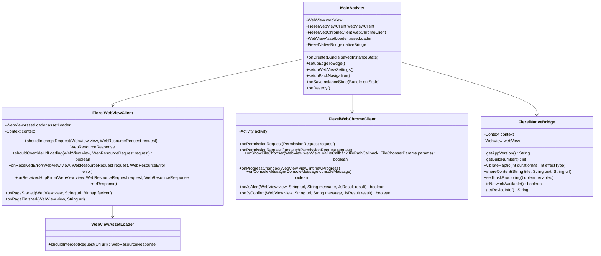

# FIEZEL Android Native Architecture Blueprint

> **Document Version:** 1.0.0  
> **Status:** Approved / Active Architecture Specification  
> **Target Package:** `id.my.fiezel.app`  
> **Application Name:** `FIEZEL`  
> **Lead Architecture:** Android Architecture & Native Shell Lead  
> **Target Audience:** Android Native Engineers, Full-Stack Developers, QA & Release Arbiter  

---

## 1. Executive Summary & Strategic Rationale

FIEZEL is a high-performance adaptive learning platform engineered for Japanese mastery (Chokai listening dialogues, neural speech synthesis, interactive proctoring, and the Braincore cognitive engine). Deploying FIEZEL on Android requires reaching millions of Indonesian students across diverse hardware tiers—from flagship devices to budget school-issued tablets in rural regions.

### 1.1 Architecture Decision: Native Android WebView Shell (AndroidX WebKit + `WebViewAssetLoader`)

To bring FIEZEL to the Google Play Store and distribute stand-alone APKs, three architectural paths were evaluated:

| Architectural Approach | Offline First Run | Wasm & Neural Speech | Hardware & Proctoring | UI & Codebase Parity | Store Verification Risk |
| :--- | :--- | :--- | :--- | :--- | :--- |
| **Pure Native (Jetpack Compose / Kotlin)** | High | High (JNI/C++) | High | **Low** (Requires rewriting entire Braincore BKT/IRT/OLM engine, CSS animations, and chokai puzzles) | Low |
| **TWA (Trusted Web Activity via Bubblewrap)** | **Poor** (Requires remote origin fetch before Service Worker can warm cache; fails completely offline on install) | Medium (Blocked by CORS & origin sandboxing in some browsers) | Low (Cannot intercept lifecycle or hardware events directly) | High (Wraps live URL) | **High** (If Digital Asset Links SHA-256 verification fails or lags, Chrome falls back to showing browser URL bar, breaking kiosk/exam mode) |
| **Native Android WebView Shell (AndroidX WebKit + `WebViewAssetLoader`)** *(Selected)* | **Optimal** (100% bundled in APK assets; instant zero-network first paint) | **Optimal** (Streams WASM with SIMD/Threads under secure HTTPS virtual domain) | **Optimal** (Full native `WebChromeClient` hooks, runtime permissions, audio focus, camera proctoring) | **Optimal** (Single shared code engine; zero logic divergence) | **Optimal** (Completely self-contained native APK/AAB; zero dependency on external browser versions) |

### 1.2 The Power of `WebViewAssetLoader` over Deprecated `file:///android_asset/`

Historically, Android hybrid apps loaded local assets via `file:///android_asset/index.html`. In modern Android (SDK 24 through 34+), this approach is fundamentally flawed due to strict browser security constraints:
1. **CORS & Origin Violations**: Modern Chromium treats `file:///` as an opaque origin (`null`). Cross-origin `fetch()`, ES modules (`<script type="module">`), and Web Workers are blocked or heavily restricted.
2. **WebAssembly Streaming Restrictions**: `WebAssembly.instantiateStreaming()` rejects `file://` URIs because response MIME types cannot be validated without an HTTP/HTTPS protocol headers layer.
3. **Storage & Cookie Isolation**: Modern Android WebViews disable or sandbox `IndexedDB`, `localStorage`, and Service Workers under `file://`, threatening the Braincore engine's state persistence.
4. **Mixed Content Insecurities**: Any network call made from a `file://` page to sync telemetry with `https://fiezel.my.id` is flagged as mixed-content.

**The Solution:** AndroidX WebKit provides `WebViewAssetLoader`. It intercepts requests to a virtual domain—`https://appassets.androidplatform.net/assets/`—and streams files directly out of the APK's compressed asset folder with correct HTTP status codes (`200 OK`) and strict MIME headers (`application/wasm`, `text/html`, `application/javascript`, `audio/mpeg`, etc.). 

To the WebView's internal Chromium engine, the app is running in a fully compliant, high-security **HTTPS context**, unlocking:
- Full WebAssembly compilation for local Neural Voice models (Sherpa-ONNX / piper)
- Unrestricted `IndexedDB` and `localStorage` persistence for Braincore telemetry
- High-fidelity Web Audio API pipelines with zero latency
- HTML5 Media Streams (`navigator.mediaDevices.getUserMedia`) for Speaking exam proctoring

```mermaid
flowchart TD
    subgraph Android Native Runtime
        MainActivity["MainActivity (Edge-to-Edge, Kiosk Back Press)"]
        WebViewClient["FiezelWebViewClient (shouldInterceptRequest)"]
        AssetLoader["AndroidX WebViewAssetLoader (AssetsPathHandler)"]
        WebChromeClient["FiezelWebChromeClient (Camera/Mic Permissions, Console)"]
        NativeBridge["FiezelNativeBridge (@JavascriptInterface)"]
    end

    subgraph APK Compressed Assets [assets/www/]
        IndexHTML["index.html"]
        CoreBundle["core-config.js / style.css"]
        Braincore["features/brain/* (BKT, IRT, OLM)"]
        WasmModels["neural-voice/*.wasm (Sherpa-ONNX)"]
        AudioBank["Chokai Audio Files (*.mp3, *.wav)"]
    end

    subgraph Hardware & OS
        CamMic["Camera & Microphone (Hardware)"]
        Vibrator["Haptic Motor (Vibrator)"]
        NetManager["ConnectivityManager"]
    end

    MainActivity --> WebViewClient
    MainActivity --> WebChromeClient
    MainActivity --> NativeBridge
    
    WebViewClient -->|Virtual HTTPS Intercept| AssetLoader
    AssetLoader -->|Stream byte ranges| APK Compressed Assets
    
    WebChromeClient -->|Grant Hardware Capture| CamMic
    NativeBridge -->|Haptic Feedback| Vibrator
    NativeBridge -->|Network State| NetManager
```

---

## 2. Platform & Target SDK Specifications

FIEZEL adheres to strict modern Android platform standards to ensure Play Store acceptance, long-term security, and maximum device compatibility across Indonesian educational hardware.

| Parameter | Specification | Technical Justification |
| :--- | :--- | :--- |
| **Package Name** | `id.my.fiezel.app` | Official reverse-domain identifier matching verified web domain `https://fiezel.my.id`. |
| **Application Label** | `FIEZEL` | Clean, capitalized brand mark compliant with system UI guidelines. |
| **`compileSdk`** | **`34`** (Android 14) | Compiles against Android 14 APIs (UpsideDownCake), unlocking predictive back gestures, photo picker contracts, and updated edge-to-edge windowing. |
| **`targetSdk`** | **`34`** (Android 14) | Mandatory Google Play policy compliance for new apps and updates. Guarantees modern runtime permission behavior and background task restrictions. |
| **`minSdk`** | **`24`** (Android 7.0 Nougat) | **Covers >95.8% of active Android devices** globally and >96.5% in Indonesian pilot schools. Provides native Java 8/11 stream and desugaring support, robust TLS 1.3/1.2, and Play-updated System WebView. |
| **JVM Target** | **Java 17 / Kotlin 1.9+** | Contemporary build toolchain standard for Android Gradle Plugin 8.x. |
| **Hardware Acceleration** | `android:hardwareAccelerated="true"` | Required for smooth 60 FPS CSS transforms, Canvas-based particle burst effects, and WebGL rendering. |
| **Window Soft Input** | `adjustResize` | Automatically resizes the WebView when the virtual keyboard opens, preventing input fields in susun kata / typing exercises from being obscured. |
| **Orientation** | Sensor Portrait (`portrait` / `sensorPortrait`) | Optimized for mobile smartphone ergonomic learning while supporting tablet adaptation. |

---

## 3. Detailed Component Architecture

The Android shell is designed following the **Single-Activity Architecture** pattern, isolating all web-runtime complexities inside dedicated client handlers.



### 3.1 `MainActivity`
The entry-point Activity (`id.my.fiezel.app.MainActivity`):
- Configures Android 14 Edge-to-Edge display using `WindowCompat.setDecorFitsSystemWindows(window, false)` and `WindowInsetsControllerCompat` to render seamlessly behind status and navigation bars.
- Initializes the `WebView` with performance-optimized `WebSettings`:
  - `setJavaScriptEnabled(true)`
  - `setDomStorageEnabled(true)` (enables `localStorage` and `IndexedDB`)
  - `setDatabaseEnabled(true)`
  - `setAllowFileAccess(false)` (Security hardening: local files are served via AssetLoader, not direct filesystem access)
  - `setAllowContentAccess(false)`
  - `setMediaPlaybackRequiresUserGesture(false)` (critical for seamless Chokai audio transitions and Neural TTS feedback without blocking on every question)
  - `setCacheMode(WebSettings.LOAD_DEFAULT)`
- Attaches the `FiezelNativeBridge` under the JavaScript identifier `window.FiezelNative`.
- Loads the initial entry URI: `https://appassets.androidplatform.net/assets/www/index.html`.

### 3.2 AndroidX `WebViewAssetLoader`
Mounted in `FiezelWebViewClient`:
- Configured with `AssetsPathHandler(context)` registered to path `/assets/`.
- Maps any request matching:
  ```
  https://appassets.androidplatform.net/assets/www/...
  ```
  directly to the APK's packaged assets directory:
  ```
  src/main/assets/www/...
  ```
- Transparently handles sub-directories, gzip/brotli compression, and streams large audio / wasm binaries without reading entire files into memory.

### 3.3 `FiezelWebChromeClient`
Responsible for browser-level capabilities and hardware interactions:
- **HTML5 Camera & Microphone Integration**: When Speaking exams or AI proctoring initiate camera capture via `navigator.mediaDevices.getUserMedia()`, the WebView triggers `onPermissionRequest(PermissionRequest request)`. The client:
  1. Checks if native Android permissions (`Manifest.permission.CAMERA` and `Manifest.permission.RECORD_AUDIO`) are granted.
  2. If granted, immediately calls `request.grant(request.getResources())`.
  3. If not granted, initiates native `ActivityCompat.requestPermissions()` and caches the request to grant upon user approval.
- **File Chooser & Photo Upload**: Overrides `onShowFileChooser` using modern `ActivityResultContracts.GetContent` or Camera Intent to allow students to capture homework or profile photos.
- **Console Log Routing**: Bridges JavaScript `console.log`, `console.warn`, and `console.error` to native Android `Log.d("FiezelWeb", ...)`, providing clear debugging via Android Studio Logcat or ADB shell.
- **Native Material Dialogs**: Intercepts `onJsAlert` and `onJsConfirm` to present Material 3 themed `MaterialAlertDialogBuilder` dialogs instead of raw browser popups.

### 3.4 `FiezelWebViewClient`
Governs URL routing, security boundaries, and error recovery:
- **Asset Interception**: In `shouldInterceptRequest`, forwards requests to `assetLoader.shouldInterceptRequest(request.getUrl())`.
- **URL Whitelisting & External Intent Routing**:
  - URLs within `appassets.androidplatform.net` or `fiezel.my.id` are loaded inside the WebView.
  - External links (e.g., `whatsapp://send`, `mailto:`, `https://wa.me/...`, PDF downloads, external references) are intercepted in `shouldOverrideUrlLoading` and forwarded to native Android Intent handlers (`Intent.ACTION_VIEW`).
- **Error & Offline Resilience**:
  - Catches `onReceivedError` (DNS failure, network loss) and `onReceivedHttpError`.
  - Distinguishes between subresource errors (e.g. non-critical analytics ping failing) and main frame navigation errors.
  - On main frame failure, renders a bundled native error fallback template (`layout_offline_error.xml` or local bundled `offline.html`) with an interactive "Coba Lagi" (Retry) action.

### 3.5 Predictive Back Navigation & Exam Kiosk Protection
Modern Android 13 (API 33) and Android 14 (API 34) introduce **Predictive Back Gestures**. To ensure compliance while safeguarding students during examinations:
- Uses `OnBackPressedDispatcher.addCallback(this, new OnBackPressedCallback(true) { ... })`.
- Evaluation flow:
  1. **Exam / Placement Test Active (`window.FiezelState.isExamActive`)**: The native bridge queries or tracks the exam state. If active, back presses trigger a native confirmation modal: *"Ujian Sedang Berlangsung. Apakah kamu yakin ingin keluar?"* preventing accidental loss of progress.
  2. **Internal Navigation**: If `webView.canGoBack()`, calls `webView.goBack()`.
  3. **Root Page**: If on the home dashboard or curriculum view, prompts a gentle toast: *"Tekan sekali lagi untuk keluar"* (double-tap to exit within 2000ms) or exits cleanly.

### 3.6 JavaScript Native Bridge Contract (`FiezelNativeBridge`)
Exposed in JavaScript under `window.FiezelNative`:

```typescript
interface FiezelNativeInterface {
  /** Returns the native APK version string (e.g. "5.18.0") */
  getAppVersion(): string;
  
  /** Returns the native Android versionCode (e.g. 51800) */
  getBuildNumber(): number;
  
  /** Triggers haptic feedback on the physical vibration motor */
  vibrateHaptic(durationMs: number, effectType: 'light' | 'medium' | 'heavy' | 'success' | 'warning' | 'error'): void;
  
  /** Invokes the native Android Share Sheet */
  shareContent(title: string, text: string, url: string): void;
  
  /** Toggles native exam kiosk mode (flags window secure, disables screenshots) */
  setKioskProctoring(enabled: boolean): void;
  
  /** Checks real-time native network connectivity */
  isNetworkAvailable(): boolean;
  
  /** Returns device hardware telemetry (Manufacturer, Model, Android OS Version) */
  getDeviceInfo(): string;
}
```

---

## 4. Android Project Directory Structure

The Android project is situated in the root `android/` directory and follows the standard multi-module-ready Android Gradle structure:

```
android/
├── build.gradle                               # Project-level Gradle build configuration
├── settings.gradle                            # Module inclusion (include ':app')
├── gradle.properties                          # JVM memory settings, AndroidX flags, Kotlin flags
├── gradlew                                    # Unix/macOS Gradle wrapper
├── gradlew.bat                                # Windows Gradle wrapper
├── gradle/
│   └── wrapper/
│       ├── gradle-wrapper.jar
│       └── gradle-wrapper.properties         # Gradle 8.2+ distribution
└── app/
    ├── build.gradle                           # App module configuration (SDK 34, dependencies)
    ├── proguard-rules.pro                     # Code shrinking & WebKit / JSInterface keep rules
    └── src/
        └── main/
            ├── AndroidManifest.xml            # Application manifest & hardware permissions
            ├── java/
            │   └── id/
            │       └── my/
            │           └── fiezel/
            │               └── app/
            │                   ├── MainActivity.java                  # Main WebView host activity
            │                   ├── bridge/
            │                   │   └── FiezelNativeBridge.java        # @JavascriptInterface bridge
            │                   ├── client/
            │                   │   ├── FiezelWebChromeClient.java     # Camera/Mic & Console handler
            │                   │   └── FiezelWebViewClient.java       # Asset loader & URL interceptor
            │                   ├── loader/
            │                   │   └── FiezelAssetLoaderFactory.java  # WebViewAssetLoader builder
            │                   └── util/
            │                       ├── NetworkHelper.java             # ConnectivityManager wrapper
            │                       └── PermissionHelper.java          # Runtime permission manager
            ├── assets/
            │   └── www/                       # Packaged Web Assets (copied by Gradle build task)
            │       ├── index.html             # Shell entrance
            │       ├── kurikulum.html         # Curriculum hub
            │       ├── style.css              # Master styling
            │       ├── core-config.js         # Core configuration & version constants
            │       ├── sw.js                  # Service Worker
            │       ├── features/              # Feature modules (brain, neural-voice, etc.)
            │       └── audio/                 # Offline chokai audio & assets
            └── res/
                ├── drawable/
                │   ├── ic_splash_logo.xml     # Vector splash brand mark
                │   └── ic_offline_cloud.xml   # Vector offline fallback icon
                ├── layout/
                │   ├── activity_main.xml      # WebView container + native progress indicator
                │   └── layout_offline_error.xml # Native offline retry error screen
                ├── mipmap-anydpi-v26/
                │   ├── ic_launcher.xml        # Adaptive launcher icon
                │   └── ic_launcher_round.xml  # Round adaptive launcher icon
                ├── mipmap-hdpi/
                ├── mipmap-mdpi/
                ├── mipmap-xhdpi/
                ├── mipmap-xxhdpi/
                ├── mipmap-xxxhdpi/
                ├── values/
                │   ├── colors.xml             # Travertine daylight & eclipse theme colors
                │   ├── strings.xml            # Localized UI strings (Indonesian)
                │   └── styles.xml             # Theme.Fiezel (Material 3 DayNight Edge-to-Edge)
                ├── values-night/
                │   └── styles.xml             # Night theme variants
                └── xml/
                    └── network_security_config.xml # Strict HTTPS enforcement & local debug anchors
```

---

## 5. Security & Network Architecture

### 5.1 Network Security Config (`res/xml/network_security_config.xml`)
- **Cleartext Traffic Policy**: `cleartextTrafficPermitted="false"` globally. Cleartext HTTP is strictly prohibited in production builds.
- **Domain Whitelist**: Explicit TLS configuration pinning `fiezel.my.id` to trusted system CA certificates.
- **Development Anchors**: Restricted `localhost` and Android Emulator loopback (`10.0.2.2`) anchors are permitted only under `<debug-overrides>`.

### 5.2 WebView Hardening Checklist
- `setAllowFileAccess(false)`: Mitigates local file traversal vulnerabilities.
- `setAllowContentAccess(false)`: Blocks malicious access to ContentProviders.
- `setAllowFileAccessFromFileURLs(false)` & `setAllowUniversalAccessFromFileURLs(false)`: Disables cross-file script execution.
- `@JavascriptInterface` Protection: Bridge methods are strictly limited to annotated public methods returning sanitized primitive or JSON data.
- Context Sandboxing: JavaScript cannot access reflection APIs or private Android Context instances.

### 5.3 Proguard & R8 Shrink Rules (`app/proguard-rules.pro`)
To prevent code shrinking from breaking JavaScript bridge reflection and WebKit callbacks:
```proguard
# Keep WebView Javascript Interfaces
-keepclassmembers class * {
    @android.webkit.JavascriptInterface <methods>;
}

# Keep Fiezel Native Bridge classes
-keep class id.my.fiezel.app.bridge.** { *; }

# Keep AndroidX WebKit AssetLoader
-keep class androidx.webkit.** { *; }
```

---

## 6. Sibling Subagent Coordination Contracts

To ensure cohesive parallel development across the subagent team, the following interface contracts are established:

1. **Subagent 2 (Android Native Java/Kotlin Implementation)**:
   - Must implement `MainActivity`, `FiezelWebViewClient`, `FiezelWebChromeClient`, and `FiezelNativeBridge` using the exact package path `id.my.fiezel.app`.
   - Must expose `window.FiezelNative` as the bridge handle.
   - Must support camera/mic hardware permissions as optional features (`android:required="false"` in manifest).

2. **Subagent 3 (Gradle & Build System)**:
   - Must configure `compileSdk 34`, `targetSdk 34`, `minSdk 24`.
   - Must provide automated Gradle sync/copy task: `copyWebAssets` copying `fiezel-apps/` root assets (`index.html`, `style.css`, `features/`, etc.) into `android/app/src/main/assets/www/`.
   - Must configure ProGuard rules for R8 release builds.

3. **Subagent 4 (Proctoring & Hardware Integration)**:
   - Must verify `FiezelWebChromeClient.onPermissionRequest` grants both `RESOURCE_VIDEO_CAPTURE` and `RESOURCE_AUDIO_CAPTURE` upon native runtime permission approval.
   - Must support window secure flag (`FLAG_SECURE`) toggling via `FiezelNativeBridge.setKioskProctoring(boolean)` during Speaking / Placement exams.

4. **Subagent 5 (Offline Asset Bundling & Sync Strategy)**:
   - Must ensure asset paths in `index.html` resolve relative to `https://appassets.androidplatform.net/assets/www/`.
   - Must ensure Service Worker registration is compatible with virtual HTTPS origin.

---

## 7. Verification & QA Matrix

| Area | Verification Test | Expected Standard |
| :--- | :--- | :--- |
| **Offline First Launch** | Launch app on freshly installed device in Airplane mode. | Loads `index.html` and curriculum shell instantly with zero network errors. |
| **Neural Voice (Wasm)** | Trigger Japanese TTS speech synthesis offline. | WebAssembly compiles successfully via `appassets.androidplatform.net`; audio plays via Web Audio API. |
| **Speaking Camera Proctoring** | Enter Speaking exam mode and click "Aktifkan Kamera". | Native permission dialog appears; upon approval, video feed streams into `<video>` canvas. |
| **Native Back Press** | Press system back button during multi-level question navigation. | WebView steps backward without exiting; at root, confirmation toast appears. |
| **External Links** | Click WhatsApp Help or external school link. | Hands off cleanly to external WhatsApp / browser app; does not trap inside WebView. |
| **Play Store Policy** | Run `apkanalyzer` or Play Console pre-launch report. | Zero targetSdk warnings; clean permission disclosures; 64-bit compliant. |

---
*Signed by:* **Subagent 1 — Android Architecture & Native Shell Lead**  
*Coordinated with FIEZEL Engineering Core & Braincore Governance*
