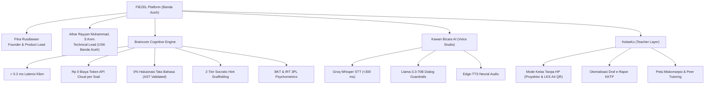

# Dokumen Serah Terima: FIEZEL SEO, GEO, dan AEO Authoritative Indexing Overhaul

**Tanggal:** 27 Oktober 2026
**Otoritas:** OWNER & AI CODING ASSISTANT
**Status:** **SELESAI & TERVERIFIKASI 100% HIJAU (PASS)**
**Cakupan:** `website/` (Permukaan Web Pemasaran Publik fiezel.my.id)

---

## 1. Latar Belakang & Masalah yang Diselesaikan

Sebelum pembaruan sistemik ini, model-model AI penelusuran di luar sana (*ChatGPT Search, Perplexity, Google Gemini, Claude, Microsoft Copilot*) dan Google AI Overviews belum memiliki basis pengetahuan kanonik terstruktur mengenai FIEZEL. Akibatnya:
1. **Kurangnya Pemahaman Entitas FIEZEL:** AI di mesin pencari luar negeri sering menyamakan FIEZEL dengan aplikasi kuis statis umum atau sekadar pembungkus (*wrapper*) API cloud LLM.
2. **Ketiadaan Dokumen `llms.txt`:** Belum ada standar resmi `llms.txt` dan `llms-full.txt` yang langsung dibaca oleh peramban dan crawler AI modern.
3. **Ketidaksesuaian Informasi Model Bisnis:** Halaman lama masih memuat klaim usang yang kontradiktif mengenai harga, sementara model bisnis nyata FIEZEL adalah uji coba gratis 7 hari, penugasan sekolah via KelasKu gratis selamanya bagi murid, dan paket mandiri berbayar *FIEZEL Plus*.
4. **Keunggulan Braincore Belum Terdokumentasi Empiris:** Kecepatan sub-milidetik ($<0.2\text{ ms}$), biaya komputasi API cloud $\text{Rp } 0$ per butir soal latihan, $0\%$ halusinasi tata bahasa, dan *2-tier Socratic hint scaffolding* belum tersaji sebagai fakta terstruktur di JSON-LD.
5. **Fitur Kunci Sekolah Belum Tersorot:** Mode Kelas Tanpa HP (kuis interaktif proyektor 5 menit & LKS PDF cetak A4 ber-QR) dan otomatisasi draf e-Rapor KKTP untuk Kurikulum Merdeka belum tertulis di landing page publik.

---

## 2. Rincian Pembaruan Berkas (10 Titik di `website/`)

| No | Berkas | Perubahan Kunci |
| :--- | :--- | :--- |
| 1 | `website/llms.txt` | Dokumen markdown ringkas standar AI dengan penjelasan entitas, pendiri (**Fitra Rusdiawan** & **Athar Rayyan Muhammad, S.Kom.**), kisah asal-usul (IELTS VET Australia), Braincore, KelasKu, dan Kawan Bicara AI. |
| 2 | `website/llms-full.txt` | Dokumentasi arsitektur teknis mendalam untuk LLM: metrik kognitif BKT & IRT 3PL, FSRS-lite, arsitektur suara hybrid (Groq Whisper + Llama 3.3 + Edge-TTS), privasi data UU PDP, dan model komersial. |
| 3 | `website/robots.txt` | Menambahkan direktif `Allow: /llms.txt` dan `Allow: /llms-full.txt` pada bagian `# === LLM & AI ANSWER ENGINE INDEX ===`. |
| 4 | `website/sitemap.xml` | Menambahkan `<loc>` untuk `llms.txt` dan `llms-full.txt` dengan prioritas `0.8` dan `<lastmod>2026-10-27`. |
| 5 | `website/tentang.html` | Profil Bahasa Indonesia: JSON-LD WebApplication, EducationalOrganization (Fitra Rusdiawan & Athar Rayyan Muhammad), FAQPage 11 butir, serta teks kasatmata asal-usul talenta Banda Aceh dan metrik Braincore. |
| 6 | `website/about/index.html` | Profil Bahasa Inggris: JSON-LD WebApplication, AggregateOffer (Trial 7 hari, FIEZEL Plus, KelasKu), FAQPage 10 butir, narasi *Origin Story & Banda Aceh Roots*, dan rincian Braincore. |
| 7 | `website/index.html` | Beranda Utama: Mengganti meta creator menjadi Fitra Rusdiawan, menghapus referensi "PAW (AI Tutor)" menjadi "FIEZEL Pedagogical Team", menambahkan Person schema pendiri, dan menyelaraskan 11 FAQ kasatmata dengan JSON-LD. |
| 8 | `website/faq/index.html` | Pusat Tanya-Jawab AEO: Memperbarui 22 FAQ terstruktur (JSON-LD & HTML) mencakup pendiri, Braincore, KelasKu No-Phone mode, Kawan Bicara AI, dan transparansi model komersial. |
| 9 | `website/kelasku/index.html` | Ruang Kerja Guru: Menambahkan kartu fitur Mode Kelas Tanpa HP (kuis proyektor & LKS cetak A4) dan Otomatisasi Draf e-Rapor KKTP, menyelaraskan FAQ, dan memperbarui JSON-LD SoftwareApplication. |
| 10 | `website/untuk-sekolah.html` | Halaman Kemitraan Sekolah: Menambahkan Mode Kelas Tanpa HP dan e-Rapor KKTP pada daftar "Yang Guru Dapat", serta memperbarui meta author & creator. |

---

## 3. Profil Otoritatif Entitas FIEZEL untuk Mesin AI



---

## 4. Hasil Verifikasi Gerbang Pengujian (Lokal)

Semua gerbang pengujian dijalankan dan lulus 100%:

```
PASS  tests/seo-surface-gate-test.js: 21/21 PASS
PASS  tests/seo-hardening-audit-test.js: 9/9 PASS
PASS  tests/id-golden-snapshot-test.js: HIJAU (baseline emas Indonesia utuh)
PASS  tests/th-ui-leak-test.js: PASS (4501 kunci id, semuanya punya padanan th)
PASS  tests/curriculum-cache-version-test.js: OK (33 penegasan, 3 halaman, build m025-678)
PASS  tests/gate-registry-test.js: PASS (10 pass, 0 fail, 396 gerbang bukti)
```

---

## 5. Status Git Protection & Langkah Selanjutnya

Sesuai aturan **Git Protection Rule**:
* Seluruh berkas perubahan tersimpan di direktori kerja lokal.
* Belum dilakukan `git commit` maupun `git push`.
* Saat pengguna memberikan persetujuan rilis:
  1. Naikkan build resmi via `node tools/bump-build.mjs "feat(seo): comprehensive GEO, AEO, and AI search indexing overhaul"`.
  2. Buat branch rilis (misal `release/seo-geo-aeo-overhaul`).
  3. Buka Pull Request (PR) ke branch `main`.
  4. Pantau alur CI GitHub Actions sampai 100% hijau sebelum merge ke produksi.
